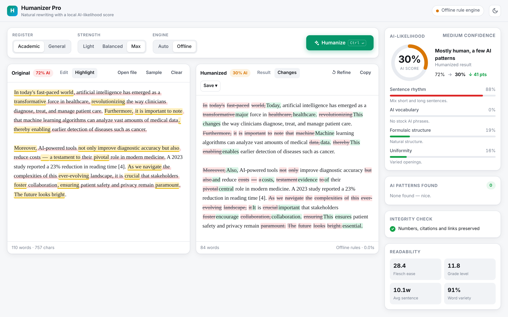
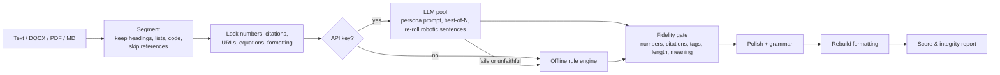

# Humanizer Pro

<div align="center">

[](https://github.com/Kamran5H/Humanizer/actions/workflows/ci.yml)
[](LICENSE)
[](pyproject.toml)
[](#offline-and-privacy)

**Rewrite formulaic text into clearer prose, with a local writing-pattern index.**

The index is **not a probability or percentage of AI authorship**, and is not
calibrated against Turnitin. A result of 13/100 here does not contradict or predict
an 87% Turnitin report. No rewriting mode guarantees a detector outcome or perfect
semantic equivalence; review the revised text against the original.

Turnitin defines its percentage over qualifying prose. Its current
[integration guidance](https://helpcenter.turnitin.com/hc/en-us/articles/49302416618637-How-do-I-display-and-access-the-AI-Writing-score-in-a-custom-API-integration)
says the AI Writing score is not exposed directly through its Core API. Compare
against an authorized Turnitin report rather than presenting this local index
as a Turnitin score.

For Word input, use **Download → Word document (.docx)**. Each result has its own
download file, independent of later uploads and jobs. The original DOCX package's
non-document parts (styles, figures, headers, footers, embedded files and other
metadata) are copied unchanged; body text is updated while retaining paragraph
and run formatting. Browser jobs also rewrite headings, while reference lists,
fields, equations and other protected content stay intact. Changed text may reflow
across lines or pages. **PDF input is text extraction only; original PDF layout
is not retained.**

Editing the result in the plain-text editor cannot safely update Word formatting.
TXT/Markdown downloads include those edits; a formatted DOCX download reports a
conflict rather than silently losing the edits or formatting. To edit the formatted
result, download it and use Word. **Refine** reuses the formatted Word package
when the result has not been manually edited.

Studio **AI** mode requires a configured API key and fails clearly if no safe AI
rewrite is available. **Offline** is an explicit alternative. See [provider setup](PROVIDERS.md)
for OpenAI, native Claude/Anthropic, and other supported APIs.

[Quick start](#quick-start) · [Web studio](#web-studio) · [Command line](#command-line) · [Python API](#python-api) · [How it works](#how-it-works) · [Providers](PROVIDERS.md)



</div>

## What it does

- **Rewrites** AI-generated drafts so they read like a person wrote them: varied sentence rhythm, plain verbs, no stock phrases.
- **Explains** the result with a local AI-likelihood score broken into signals you can act on (rhythm, AI vocabulary, formulaic structure, uniformity) and highlights every offending phrase with a suggested fix.
- **Checks factual anchors.** Rewrites are checked for numeric changes, dropped citations, changed negation and malformed formatting tokens. These checks reduce errors but cannot prove that meaning is unchanged.
- **Keeps Word formatting.** Bold, italics, colours, fonts, superscript citations, hyperlinks, Zotero/Mendeley/EndNote citation fields, footnotes and images survive. Studio jobs can rewrite headings; reference lists are left alone.
- **AI or offline rewriting.** AI mode uses configured providers with automatic failover and reports failures. Select Offline to use the local rule engine without an API key. Legacy scripts may opt into offline fallback.
- **Two registers.** *Academic* keeps a formal tone and never touches domain terms (catalyst, spectrum, yield, significant, robust …). *General* allows contractions and plainer wording.

## Quick start

```bash
git clone https://github.com/Kamran5H/Humanizer.git
cd Humanizer
python -m venv .venv && source .venv/bin/activate      # Windows: .venv\Scripts\activate
pip install -r requirements.txt
python humanizer_pro.py                                 # opens the web studio in your browser
```

Optional: copy `.env.example` to `.env` and paste in any API key for LLM-quality rewrites (see [PROVIDERS.md](PROVIDERS.md)). One free key is enough.

On Windows you can double-click `run_humanizer.vbs` to start the studio silently.

## Web studio

`python humanizer_pro.py` (or `humanizer --web`) starts the studio at <http://127.0.0.1:8000>.

| | |
|---|---|
| **Live analysis** | The score updates as you type. *Highlight* marks every AI pattern and machine-sounding sentence; click a pattern in the sidebar to jump to it. |
| **Humanize** | Choose register, strength (Light / Balanced / Max) and engine (AI / Offline), then press **Ctrl + Enter**. Progress is live and **Esc** cancels (the partial result is kept). |
| **Changes** | Word-level diff of exactly what was rewritten. |
| **Integrity check** | Reports issues found by basic checks; review the result for meaning and factual accuracy. |
| **Files** | Drop or open `.docx`, `.pdf`, `.txt` or `.md`. Word files are rewritten in place with their formatting and downloaded as `.docx`. |
| **Refine** | Moves the result back into the input for another pass. |

It works entirely offline (no external fonts or scripts), remembers your draft and settings, and has light and dark themes.

## Command line

```bash
pip install -e .                       # installs the `humanizer` command (or use: python -m humanizer.cli)

humanizer essay.docx                   # -> essay_humanized.docx, formatting preserved
humanizer notes.md -o clean.md         # Markdown structure (headings, lists, code) preserved
humanizer report.pdf --general         # PDF text -> report_humanized.txt, conversational register
cat draft.txt | humanizer --stdin --local > out.txt   # offline only: nothing leaves your machine
humanizer --analyze draft.txt          # score + list of AI patterns, no rewriting
humanizer --text "..." --json          # machine-readable result incl. integrity report
```

Useful flags: `--level 1|2|3`, `--academic` (default) / `--general`, `--local`, `--seed N` (reproducible offline output), `--workers N`, `--no-report`, `--gui`.

## Python API

```python
from humanizer import HumanizerConfig, humanize_text, humanize_docx, analyze

cfg = HumanizerConfig(scientific=True, stealth_level=3)   # use_gemini=False forces offline
print(humanize_text("Furthermore, it is important to note that ...", cfg))
print(cfg.engine_used)                                    # "llm", "rules" or "mixed"

humanize_docx("paper.docx", cfg, dst="paper_humanized.docx")

report = analyze(text)            # score, verdict, signals, tells (with offsets), sentence scores
```

## How it works



**Pattern catalogue.** `humanizer/patterns.py` is the single list of AI-writing tells used by the detector, the rewriter, the linter and the LLM prompt. It combines the project's own measured tells with the categories documented in Wikipedia's [*Signs of AI writing*](https://en.wikipedia.org/wiki/Wikipedia:Signs_of_AI_writing) guide and the open-source [blader/humanizer](https://github.com/blader/humanizer) skill:

| Category | Example | Fix |
|---|---|---|
| AI vocabulary | *delve, leverage, pivotal, tapestry, showcase* | plain word |
| Inflated significance | *plays a crucial role in, stands as a testament to* | state the fact |
| Copula avoidance | *serves as a, boasts* | *is, has* |
| Formulaic transitions | *Furthermore, Moreover, Ultimately,* | drop or vary |
| Shallow *-ing* tails | *…, highlighting the need for* | separate sentence |
| Negative parallelism | *not only X but also Y* | *X and Y* |
| Filler & hedging | *it is important to note that, could potentially* | delete |
| Chatbot residue | *I hope this helps, As of my last update* | delete |
| Em-dash overuse | *X — Y — Z* | commas |
| Generic conclusions | *The future looks bright.* | delete |

**Detector.** The local score blends sentence-length burstiness, weighted pattern density, formulaic structure and uniformity, plus GPT-2 perplexity when `torch` and `transformers` are installed. On the bundled corpus, AI samples score 84–93% and human-written samples 0–20%. It is an *estimate*: it explains what makes text read as machine-written, but it does not guarantee what any third-party detector will say.

**LLM pipeline.** Each paragraph is rewritten by a rotating persona with explicit style rules. At *Balanced* and *Max*, several candidates are scored and the most natural one is kept. *Max* then re-rolls the individual sentences that still read as robotic. Every candidate must pass the fidelity gate; if none does, the paragraph falls back to the offline engine.

## Offline and privacy

- With no API key, or with *Offline* / `--local`, nothing leaves your machine.
- The studio binds to `127.0.0.1`, accepts only localhost `Host` headers and sends no CORS headers, so other websites cannot use it or your keys.
- A `GITHUB_TOKEN` already in your environment is **not** used to call GitHub Models. Set `GITHUB_MODELS_TOKEN` (or put `GITHUB_TOKEN` in your `.env`) to opt in.
- Uploads are deleted after 24 hours. Interrupted jobs resume from a local checkpoint that is removed when the job finishes.

## Project layout

```text
humanizer/
  patterns.py   AI-writing pattern catalogue (single source of truth)
  rules.py      offline rewriter: locking, substitutions, structure repairs, grammar
  engine.py     LLM + offline orchestration, fidelity gate, text & DOCX pipelines
  detector.py   explainable AI-likelihood scoring
  providers.py  multi-provider LLM pool with failover and cooldowns
  document.py   DOCX tagging/rebuild, PDF/TXT/MD extraction, checkpoints
  lint.py       integrity and grammar checks, readability
  text.py       sentence splitting, conjugation (no NLTK needed)
  web.py, templates/index.html   web studio
  cli.py, gui.py                 command line and desktop app
tools/detector_harness.py        optional checks against third-party detectors
tests/                           offline pytest suite
```

## Development

```bash
pip install -r requirements-dev.txt
pytest            # fully offline; API keys in your environment are ignored
ruff check .
```

Optional extras: `pip install pypdf` (PDF import, included in `requirements.txt`), `pip install ftfy` (encoding repair), `pip install torch transformers` (perplexity signal).

## License

[MIT](LICENSE) © 2024–2026 Kamran Ashraf.

---

<div align="center">

<a href="https://github.com/Kamran5H">
  
</a>

<br/>

### 👨‍💻 **Developer:** [Kamran Ashraf](https://github.com/Kamran5H)
*AI Systems Architect • Computational Physical Chemist • Automation Pioneer*

[](https://github.com/Kamran5H)
[](https://kamran5h.github.io/Portfolio/)
[](mailto:chkamran32b@gmail.com)

</div>
